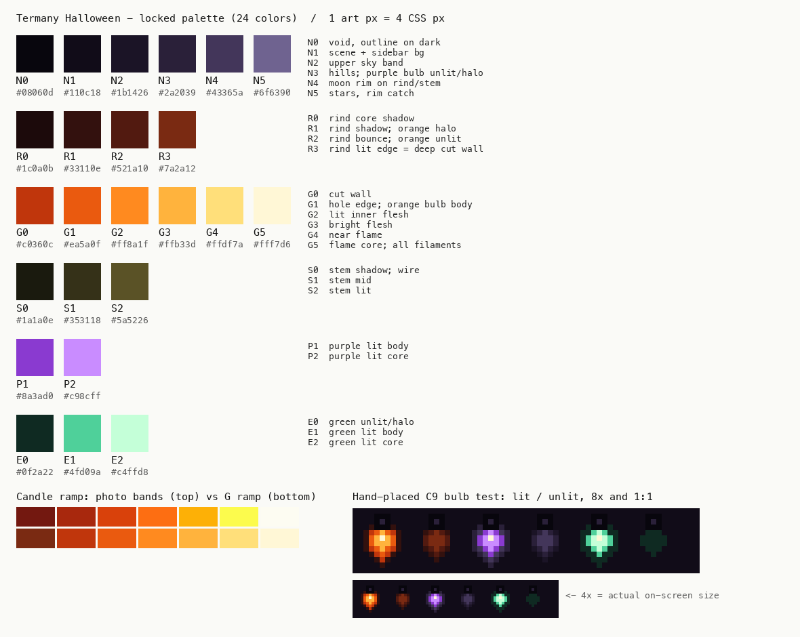

# Halloween palette

The key words MUST, MUST NOT, SHOULD, SHOULD NOT and MAY in this document are
to be interpreted as described in RFC 2119.

`palette.gpl` is the single source of truth. Aseprite and GIMP load it
directly. It holds 24 sRGB colors in six ramps. Step 0 of each ramp is the
darkest step.

## Ramps and roles

| Name | Hex | Role |
|---|---|---|
| N0 | `#08060d` | Void. Outline where a shape meets the dark. Bulb socket. |
| N1 | `#110c18` | Scene background. Sidebar background. Every bulb halo is drawn for this color. |
| N2 | `#1b1426` | Upper sky band. Shadow side of an unlit purple bulb. |
| N3 | `#2a2039` | Hills. Unlit purple bulb. Purple bulb halo. Socket highlight. |
| N4 | `#43365a` | Cool moon rim on the top-left of the rind and stem. Dark edge of a lit purple bulb. |
| N5 | `#6f6390` | Stars. Single-pixel rim catch. |
| R0 | `#1c0a0b` | Rind core shadow. |
| R1 | `#33110e` | Rind shadow. Orange bulb halo. |
| R2 | `#521a10` | Rind lit by bounce light. Unlit orange bulb. |
| R3 | `#7a2a12` | Rind edge lit by light from the holes. Also the deepest cut wall. |
| G0 | `#c0360c` | Cut wall. Dark edge of a lit orange bulb. |
| G1 | `#ea5a0f` | Edge of a carved hole. Lit orange bulb body. |
| G2 | `#ff8a1f` | Inner flesh, lit. |
| G3 | `#ffb33d` | Inner flesh, bright. Lit orange bulb core. |
| G4 | `#ffdf7a` | Flesh next to the flame. |
| G5 | `#fff7d6` | Flame core. The filament hot spot of every lit bulb. |
| S0 | `#1a1a0e` | Stem shadow. |
| S1 | `#353118` | Stem mid tone. Light-string wire (S0 is too close to N1 to read as a line). |
| S2 | `#5a5226` | Stem, lit. |
| P1 | `#8a3ad0` | Lit purple bulb body. |
| P2 | `#c98cff` | Lit purple bulb core. |
| E0 | `#0f2a22` | Unlit green bulb. Green bulb halo. |
| E1 | `#4fd09a` | Lit green bulb body. |
| E2 | `#c4ffd8` | Lit green bulb core. |

## Where the colors come from

- The G ramp follows candlelit jack-o'-lantern photos. In five Wikimedia
  Commons photos, the hue of the lit areas rises with brightness. It goes from
  about 5° (deep red) through 20° (orange) to 40–60° (yellow). Saturation stays
  above 0.9 until the brightest band. The G ramp keeps the same order.
  - The photos clip to pure yellow (`#fcfb4d`) at the top. G4 stays warmer on
    purpose. I infer that the clipping comes from the camera sensor and not
    from the flame.
- The rind is almost invisible in the photos. It reads as dark red, not
  brown. R0–R2 keep that look.
- The N ramp sits at hue 300° in OKLCH. That is the complement of the candle
  ramp, so the pumpkin separates from the sky by hue as well as by lightness.
- The bulbs follow C7/C9 Halloween strings: orange, purple and green painted
  glass on black sockets.
- Native game sprites were studied and not copied: the Stardew Valley
  Jack-O-Lantern (16×16, 10 colors), and OpenGameArt sprites (34×31 at 16
  colors, 32×32 at 5 colors). Lesson: a pumpkin reads with 10–16 colors, and
  the outline takes the hue of the shadow instead of black.

## Rules

### Palette

- **PAL-1** Every opaque sprite pixel MUST be one of the 24 colors in
  `palette.gpl`.
- **PAL-2** A sprite pixel MUST be fully opaque or fully transparent.
- **PAL-3** A change to `palette.gpl` MUST come with a new palette card and a
  reviewer's approval. The CI palette audit (step 4) compares every sprite
  against this file.
- **PAL-4** The step from N0 to N1 and the step from N1 to N2 are each about
  0.04 in OKLab lightness. These steps SHOULD only fill large areas, such as
  the bands of the sky. They MUST NOT be the only edge between two shapes.
- **PAL-5** R0 MUST NOT sit on the outer edge of the pumpkin. R0 differs from
  N1 by only 0.006 in lightness, so the silhouette would disappear there.
- **PAL-6** Any theme surface behind a sprite MUST be exactly N1. IF a bulb
  hangs over any other color, THEN its halo pixels MUST be redrawn for that
  background.
- **PAL-7** Bulb color MUST NOT be the only signal of a state. Under
  simulated deuteranopia, lit orange (G1) and lit green (E1) are only 0.150
  apart in OKLab. A state change MUST also show in the frame sequence or in
  the pumpkin.

### Pixel size

- **PX-1** One art pixel MUST render as exactly 4 CSS px, for every sprite in
  the theme. At device pixel ratios 1, 1.25, 1.5, 1.75 and 2, this gives 4, 5,
  6, 7 and 8 device pixels: always a whole number.
- **PX-2** IF the space for the scene is too small, THEN the scene MUST be
  cropped. It MUST NOT be scaled.

## Checks on this version

All numbers come from `palcheck.py` (OKLab; Machado 2009 simulation at
severity 1.0). The script moves into the repository in step 4.

| Check | Result |
|---|---|
| Closest pair | N1–R0, ΔE 0.036. This pair is intended: the rind core fades into the night (PAL-5). The next pair is N0–N1, ΔE 0.039. |
| Lightness steps inside N, R, G, S | 0.038 to 0.125 |
| G ramp hue | 35° → 96° in OKLCH, rising at each step |
| Lit bulbs, normal vision | orange–green 0.314, orange–purple 0.330, purple–green 0.414 |
| Lit bulbs, deuteranopia | orange–green 0.150, orange–purple 0.343, purple–green 0.329 |
| Lit bulbs, protanopia | orange–green 0.260, orange–purple 0.304, purple–green 0.381 |

Not measured yet:

- How the palette survives the H.264 encoding that X applies to uploads.
- How the palette looks on a Display P3 panel next to sRGB terminal text.
