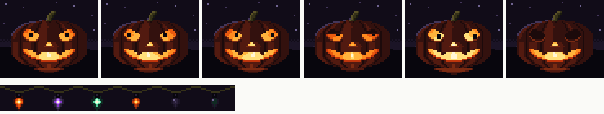

# Halloween sprites

The key words MUST, MUST NOT, SHOULD, SHOULD NOT and MAY in this document are
to be interpreted as described in RFC 2119.

## How the art is made

- Every frame is a character grid in `src/*.sprite`. One character is one art
  pixel. The legend in `scripts/halloween-sprites.mjs` maps each character to
  one color of `palette.gpl`. `.` is transparent.
- `node scripts/halloween-sprites.mjs` turns each source into
  `sheets/<name>.png` (frames in one row, 1 px per art pixel) and
  `sheets/<name>.json` (size, origin, frame offsets, tags). It only maps
  characters to colors. It computes no shading and no in-between frames.
- `--check` validates the sources and writes nothing.
- The sheets are plain RGBA PNGs. Aseprite opens them with
  File > Import Sprite Sheet, so a pixel artist can edit them there. Aseprite
  is not installed on the build machine, so no `.aseprite` file is kept.
- The right-leaning flame frame is the left-leaning frame flipped. All other
  frames are drawn one by one.

## Scene

The scene is the foot of the sidebar: 60 × 48 art pixels, which is 240 × 192
CSS px at 4 CSS px per art pixel (PX-1). The sidebar is 240 CSS px wide.
Layers, bottom to top:

| Layer | Size | Origin in scene | Frames |
|---|---|---|---|
| `backdrop` | 60 × 48 | 0, 0 | `night` |
| `pumpkin-flame` | 32 × 28 | 14, 18 | `mid`, `left`, `right`, `dim`, `flare` |
| `pumpkin-pupils` | 32 × 7 | 14, 18 | `c`, `l`, `r`, `ur`, `dr` |
| `pumpkin-lids` | 32 × 7 | 14, 18 | `open`, `half`, `shut` |
| `pumpkin-body` | 46 × 39 | 7, 7 | `body` |

The body has transparent holes. The flame, pupil and lid layers show only
through those holes, so the code stacks the layers and never masks them.

The light string is separate. It sits over the top of the pane area:

| Layer | Size | Origin | Frames |
|---|---|---|---|
| `wire` | 24 × 5 | tiles every 24 px | `segment` |
| `bulb` | 9 × 11 | 7, 5 inside each segment | `<color>-lit`, `-warm`, `-off` for orange, purple, green |

## Sequences

| Sprite | Tag | Steps (ms) | Use |
|---|---|---|---|
| flame | `idle` | 10 steps, 200–520 each, 3.2 s loop | normal |
| flame | `alert` | `flare` held | an agent waits for the user |
| flame | `still` | `mid` held | reduced motion |
| lids | `blink` | half 70, shut 110, half 70 | one blink |
| lids | `open` | `open` held | default |
| pupils | `still` | `c` held | reduced motion |
| bulb | `<color>-a/b/c` | lit 2.6–5.2 s, warm 0.2 s, off 0.9–1.8 s | normal twinkle |
| bulb | `<color>-show` | lit 4.0, warm 0.2, off 1.6, warm 0.2 = 6.0 s | share video loop |
| bulb | `<color>-steady` | lit held | reduced motion |

## Rules

- **SPR-1** Every flame and bulb step MUST last at least 180 ms. Then one
  layer makes at most 2.75 light-dark pairs per second. WCAG 2.3.1 allows 3.
- **SPR-2** The player MUST leave at least 1 s between two blinks.
- **SPR-3** WHILE a blink plays, the player MUST hold the current flame frame.
  This keeps the face region at one light-dark pair for that moment.
- **SPR-4** A gaze change MUST cut straight to the next pupil frame. A real
  saccade takes 30–50 ms, so in-between frames would look slower than an eye.
- **SPR-5** WHEN an agent starts waiting for the user, the player MUST switch
  the pupils to the frame that faces that pane and the flame to `alert`.
- **SPR-6** WHERE reduced motion is on, the player MUST use `still`, `open`,
  `still` and `<color>-steady`. The alert state MUST then show as the `flare`
  frame held, with no other motion.
- **SPR-7** In the share loop, the three bulbs MUST start their `show` tags
  2 s apart, so only one bulb is dark at a time and the loop closes at 6 s.

## Not done in this step

- The player and the app integration (step 3).
- A measured WCAG flash analysis and a PEAT run on a recording (step 4).
  The 180 ms floor above is a design limit, not a measurement.
- A check that the art survives X's H.264 encoding.
